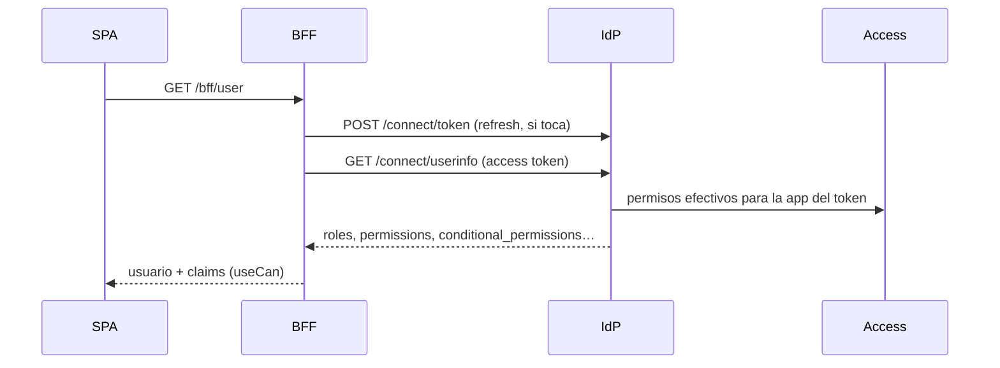
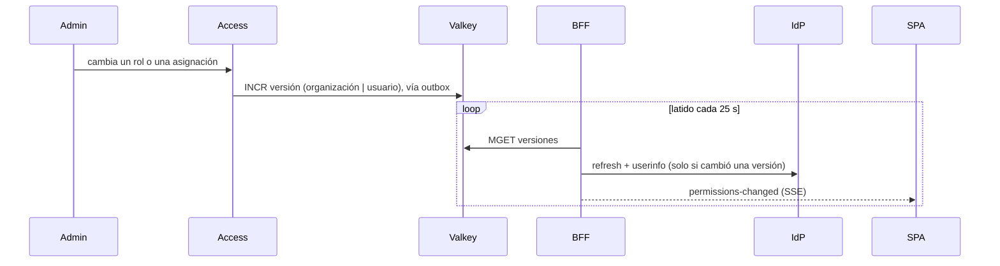
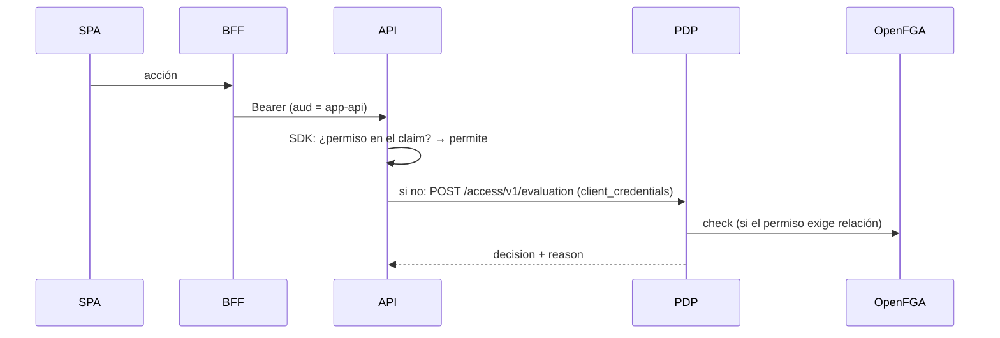
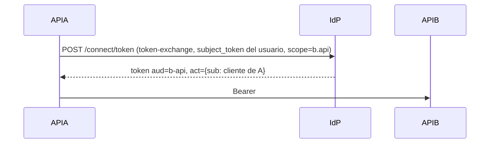

# Herensuge Access: plan para completar las fases 1 a 4

> **Estado:** en revisión EGM (versión 4, tras las etapas 5, 6 y 7) · **Fecha:** 16/11/2026
> **Diseño general:** [Autorizacion.md](Autorizacion.md) dice qué y por qué; este documento dice **cómo** se termina.
> **Decisiones:** [Docs/Decisiones](../Decisiones/), resumidas en §0.3.
> **Revisión:** [Docs/EGM/autorizacion-implementacion](../EGM/autorizacion-implementacion/). EGM (Elephant-Goldfish Model) es
> el proceso de revisión de este documento: revisores sin contexto previo lo leen por etapas y señalan lo que falta. La
> línea «Origen:» de cada decisión cita los hallazgos de esos informes (prefijos: `ZO` zoom out, `IC` inventive catalyst,
> `CO` comprensión, `DC` design critic, `ST` estructura).

---

## 0. Contexto mínimo

### 0.1 Qué es Herensuge

Herensuge es el proveedor de identidad (**IdP**: OAuth 2.1 + OpenID Connect) del SaaS B2B, construido con OpenIddict.

- **Organizaciones.** Cada organización (*tenant*) tiene miembros con un **rol base**: `owner`, `admin` o `member`.
- **Apps.** Cada app del SaaS tiene una SPA, una **BFF** (*backend for frontend*) y una API.
  - La BFF guarda los tokens en el servidor y el navegador solo tiene una cookie de sesión.
  - Las BFF se despliegan desde la plantilla `Herensuge.Bff`: una para el portal y una por cada app.
- **El portal** es la app propia de Herensuge: Mi cuenta, Organización y Plataforma. **Plataforma** es la sección de los
  administradores de todo el SaaS (**admin de plataforma**, que entra con passkey).

### 0.2 Módulos y glosario

| Pieza | Qué es |
|---|---|
| Identity | Usuarios, credenciales, MFA y sesiones SSO (`UserSession`). Cuando se cierra una sesión, su handler de dominio `NotifySessionRevokedHandler` lo publica en Valkey (`herensuge:session-revoked`) y cada BFF borra la suya (`Herensuge.Bff/Sessions/SessionRevocation.cs`) |
| Tenancy | Organizaciones, membresías e invitaciones. Expone `MembershipSnapshot` (rol base, organización activa, `RequireMfa`) |
| Oidc | OpenIddict: `/connect/authorize`, `/connect/token`, `/connect/userinfo` y los claims. El portal usa el scope `herensuge.api` (audiencia `herensuge-api`) |
| Access | El módulo de este trabajo: catálogo de permisos por app, roles y decisiones |
| Audit | Registro de los integration events |
| Common | Piezas compartidas: filtros de endpoints y *outbox* (los eventos se guardan en la misma transacción y se procesan después) |
| BFF | `Herensuge.Bff`: `/bff/login`, `/bff/user` (usuario de la sesión) y `/bff/events` (eventos al navegador por SSE, con un latido cada 25 s) |
| `@herensuge/react` | SDK de las SPA |
| **SDK .NET** | `Herensuge.Access.AspNetCore`, el SDK para las API de las apps |
| **PDP** | *Policy decision point*: la API de decisión de Access (`POST /access/v1/evaluation`), con la forma de OpenID **AuthZEN** (estándar de la OpenID Foundation para preguntar «¿puede este sujeto hacer esta acción sobre este recurso?») |
| **Evaluador** | `AccessEvaluator`, la única función que decide (§5) |
| **WP** | *Work package*: un paquete de trabajo del plan detallado, que se entrega en un PR |
| `amr`, `auth_time` | Claims estándar: métodos de autenticación (`pwd`, `otp`, `mfa`, `pop`…) y hora del inicio de sesión |
| `act` | Claim de RFC 8693: quién actúa en nombre del sujeto |
| **Rol base** | `owner`/`admin`/`member` de la membresía en Tenancy |
| **Plantilla** (`RoleTemplate`) | Rol que una app declara en su manifiesto y ofrece a todas las organizaciones |
| **`grantTo`** | Roles base que tienen una plantilla sin asignación explícita |
| **Permiso retirado** | Permiso que desaparece del manifiesto: no concede nada, pero no se borra, para no romper los roles que lo usan |
| **`shortcut:`** | Convención de comentario en el código para un atajo con límite conocido |

### 0.3 Decisiones registradas

| ADR | Decisión | Se desarrolla en |
|---|---|---|
| [A1](../Decisiones/ADR-A1-access-como-modulo.md) | Access es un módulo de `Herensuge.Api`, no un servicio | Autorizacion.md §5 |
| [A2](../Decisiones/ADR-A2-api-de-decision-authzen.md) | La PDP tiene la forma de OpenID AuthZEN | Autorizacion.md §8.1 |
| [A3](../Decisiones/ADR-A3-permisos-en-el-token.md) | Permisos en el token de cada API; lo sensible, en vivo | este doc D2, D3 |
| [A4](../Decisiones/ADR-A4-un-token-una-api.md) | Un token, una API (una audiencia) | este doc D2 |
| [A5](../Decisiones/ADR-A5-catalogo-como-codigo.md) | El catálogo es código: manifiesto sincronizado por la CI | Autorizacion.md §8.3; este doc D1 |
| [A6](../Decisiones/ADR-A6-deny-por-defecto.md) | *Deny* por defecto, sin reglas de *deny* | este doc §5 |
| [A7](../Decisiones/ADR-A7-roles-base-y-plantillas.md) | Los roles base siguen en Tenancy y conceden plantillas | este doc D1 |
| [A8](../Decisiones/ADR-A8-relaciones-con-openfga.md) | Permisos por objeto con OpenFGA, opcional | este doc D10 |
| [A9](../Decisiones/ADR-A9-condiciones-fijas.md) | Condiciones fijas, sin lenguaje de políticas | este doc D3, D9 |
| [A10](../Decisiones/ADR-A10-nombre-del-modulo.md) | El módulo se llama Access | — |
| [A11](../Decisiones/ADR-A11-sesiones-de-soporte.md) | Impersonación con sesiones de soporte de solo lectura | este doc D11 |
| [A12](../Decisiones/ADR-A12-oidc-contracts.md) | Oidc expone una fachada para las cuentas de servicio | este doc D7 |
| [A13](../Decisiones/ADR-A13-claims-en-el-id-token.md) | Los claims de acceso llegan a la BFF por `userinfo` | este doc D2 |

## 1. Problema y objetivos

**Qué falla hoy:**
- Una app del SaaS no puede decir qué puede hacer cada persona: los únicos roles son los tres de base, iguales para
  todas las apps.
- La SPA no sabe qué acciones mostrar, y el backend de una app no tiene a quién preguntar por un permiso sensible.
- Las máquinas de una organización (integraciones) no tienen identidad propia.
- No se puede compartir un objeto concreto, soporte no puede ver lo que ve un usuario y un acceso puntual exige dar un
  rol para siempre.

**Criterios de éxito por fase:**

| Fase | WP | Hecho cuando |
|---|---|---|
| 1 | WP1, WP2, WP3 | `Samples/Facturas` se integra solo con su manifiesto, su cliente y el SDK. El portal muestra y oculta acciones con `useCan`. Quitar un rol corta una operación del portal al momento y la UI se entera en menos de 30 s (con Valkey) |
| 2 | WP4 | Un permiso de una feature no contratada se deniega. Un grupo concede sus roles. Una cuenta de servicio obtiene un token con sus permisos. Una IP fuera de la red de confianza recibe `untrusted_network` |
| 3 | WP5 | Compartir un objeto con un usuario sin rol le da acceso a ese objeto (`relationMode: or`) |
| 4 | WP6 | Una sesión de soporte ve el portal del usuario y no puede cambiar nada. Una petición aprobada caduca sola. Un canje entre servicios lleva `act` |

### 1.1 No objetivos

- **Consentimiento de terceros y RAR (RFC 9396):** no hay API pública para terceros.
- **Caché de la PDP:** se abrirá un WP si el p99 de `herensuge.access.decision.duration` supera 25 ms en producción
  (DC-6).
- **Límites, fechas y *overrides* de los planes:** ninguna app los consume todavía.
- **Lote AuthZEN con un sujeto por elemento, y lenguajes de políticas (Cedar, Rego).**
- **Una SPA en el ejemplo:** el camino BFF → `useCan` es el mismo para todas las apps y lo ejercita el portal.

## 2. Punto de partida: qué existe y qué es nuevo

| Pieza | Estado |
|---|---|
| `ResourceServer`, `Permission`, `RoleTemplate`, manifiesto y su sincronización; scope y audiencia por app | existe |
| `Role`, `RoleAssignment` (usuario ↔ rol o plantilla, con caducidad) | existe |
| `roles` y `permissions` en el access token; `AccessResolver` (calcula los permisos efectivos) | existe; `AccessResolver` se absorbe en `AccessEvaluator` |
| PDP `POST /access/v1/evaluation(s)` y API de gestión | existe |
| `TenantAdministration` (comprueba «es owner o admin») | existe; pasa a `roles:manage` |
| `AccessEvaluator`, `AccessSeeder`, `RequirePermission`, `IAccessModuleApi.HasPermissionAsync`, versiones de acceso | nuevo (fase 1) |

Solo hay tests unitarios y de arquitectura en verde y un test de integración compilado (ver §10.1).

## 3. Alcance e interruptores

El solicitante pidió el sistema completo. Los revisores propusieron limitarlo a la fase 1 (ZO-1, ZO-2); se mantiene el
alcance con estas condiciones:

- **Un WP, un PR.** Un WP no está hecho hasta que su PR pasa la CI (`.github/workflows/ci.yml`): tests de integración con
  Testcontainers (PostgreSQL y Valkey reales) y comprobación de que el contrato OpenAPI y `schema.d.ts` coinciden con lo
  generado.
- **Interruptores.** Las funciones de riesgo se activan por configuración:

| Interruptor | Función | Sin él |
|---|---|---|
| `Access:OpenFga:ApiUrl` | Permisos por objeto (D10) | Los permisos que exigen relación se deniegan con `relationships_disabled` |
| `Identity:Support:Enabled` | Sesiones de soporte (D11) | Los endpoints de soporte devuelven 404 |
| `Oidc:TokenExchange:Enabled` | *Token exchange* (D14) | El *grant* no se habilita en OpenIddict |

Las migraciones de las fases 2 a 4 se aplican siempre (tablas vacías). El acceso temporal (D13) no tiene interruptor: no
concede nada sin la aprobación de alguien con `access-requests:approve`.

## 4. Flujos

**Claims de acceso hasta la SPA (D2):**



**Aviso de cambios (D4):**



**Backend de una app preguntando a la PDP (D3, D10):**



***Token exchange* (D14):**



## 5. Algoritmo de decisión

Cada paso dice qué se comprueba; si **no** se cumple, la decisión es la que va tras la flecha.

```text
evaluate(hechos, organización, app, permiso, objeto?):
  1. el permiso existe y está activo en la app                         → deny(unknown_permission)
  2. usuario: sesión activa | cliente: cuenta de servicio de la organización
                                                                       → deny(session_inactive | not_member)
  3. la organización está activa; usuario: es miembro                  → deny(not_member)
  4. la feature del permiso está contratada (plan de la org. o el plan por defecto)
                                                                       → deny(not_entitled)
  5. concesión: rol      = los roles efectivos (directos, de grupos, plantillas por rol base) incluyen el permiso
                relación = OpenFGA check(sujeto, relación, objeto), si el permiso declara relation
                se combinan según relationMode (or | and)
                                                                       → deny(no_role | no_relation | relationships_disabled | relationships_unavailable)
  6. condición: mfa → amr incluye mfa; recent_auth → ahora − auth_time < 10 min;
                trusted_network → ip pública dentro de las redes de la org. (o la org. no tiene lista);
                con act, o si el sujeto es un cliente: la condición no se cumple
                                                                       → deny(step_up_required | untrusted_network | condition_not_met)
  7. permit(granted)
```

## 6. Decisiones

### D1. Herensuge registra sus permisos como una app; el rol base sigue donde decide Tenancy (fase 1)

**Registro.**
- Al arrancar, `AccessSeeder` sincroniza el manifiesto embebido de Herensuge: clave `herensuge`, cliente
  `herensuge-portal`, audiencia `herensuge-api`.
- La clave `herensuge` está **reservada**: el endpoint de Plataforma la rechaza.
- Si dos instancias arrancan a la vez, la segunda choca con el índice único de la clave, vuelve a leer y no hace nada.
- La sincronización compara un hash del **manifiesto canónico** (JSON con listas ordenadas y sin espacios). Si coincide,
  no sube la versión ni lanza eventos.

**Permisos de Herensuge.**
- `roles:manage`, `audit:read`, `service-accounts:manage` y `access-requests:approve`, ninguno con condición.
- La plantilla `organization-admin` los tiene todos y se concede a `owner` y `admin`. Un `member` no tiene ninguno.

**Lo que sigue con el rol base.** Miembros, invitaciones y ajustes de la organización siguen gobernados por el rol base
de Tenancy, con sus reglas: solo un owner nombra owners y siempre queda uno.

**Una comprobación tiene dos pasos.**
1. **Filtro del endpoint (`RequirePermission`).** Lee el claim `permissions` del access token del portal; no consulta la
   base de datos. Su retraso es el del token: 5 min como mucho.
2. **Handler de una operación que cambia algo.** Vuelve a decidir con `IAccessModuleApi.HasPermissionAsync(tenantId,
   userId, "herensuge", permiso)`, que usa el evaluador (D8) contra la base de datos.
   - La sesión se da por activa: Herensuge ya la comprobó al validar el token (`Oidc.Infrastructure/Tokens/ValidateSessionHandler.cs`).
   - Los permisos de Herensuge no tienen condiciones.

Rutas relativas a `/api/v1`:

| Método y ruta | Filtro (token) | Handler (base de datos) |
|---|---|---|
| `GET/PATCH /tenants/{tenantId}`, `GET/PATCH/DELETE /tenants/{tenantId}/members/{userId}`, `GET/POST/DELETE /tenants/{tenantId}/invitations…` | rol base `owner`/`admin` (como hoy) | rol base (Tenancy, como hoy) |
| `GET /tenants/{tenantId}/permissions`, `GET /tenants/{tenantId}/roles`, `GET /tenants/{tenantId}/members/{userId}/roles`, `GET /tenants/{tenantId}/groups` | `roles:manage` | — |
| `POST/PATCH/DELETE /tenants/{tenantId}/roles…`, `PUT /tenants/{tenantId}/members/{userId}/roles`, `POST/PATCH/DELETE /tenants/{tenantId}/groups…` | `roles:manage` | `roles:manage` + subconjunto (D12) |
| `POST /tenants/{tenantId}/access/simulate` | `roles:manage` | `roles:manage` |
| `GET /tenants/{tenantId}/audit` | `audit:read` | — |
| `GET/POST/DELETE /tenants/{tenantId}/service-accounts…` | `service-accounts:manage` | `service-accounts:manage` + subconjunto (D12) |
| `POST /tenants/{tenantId}/access-requests/{id}/approve` y `/deny` | `access-requests:approve` | `access-requests:approve` + subconjunto (D12) |
| `/platform/…` | admin de plataforma con passkey (como hoy) | como hoy |

**Ventana de compatibilidad.**
- Al desplegar el WP1, los tokens vivos (5 min como mucho) no llevan los permisos de `herensuge`. Mientras tanto, el
  filtro acepta `tenant_role` `owner`/`admin` si el token no trae **ningún** claim `permissions`.
- Va marcada `shortcut:` y la retira el WP7, en el primer PR tras desplegar el WP1.
- Los handlers no tienen ventana.

Origen: ZO-5, IC-2, IC-7, CO-1, DC-14.

### D2. Qué viaja en el access token y qué llega a la BFF (fase 1)

**Access token.**
- `roles` (claves de plantillas) y `permissions`/`conditional_permissions` (D3) de **la app de su audiencia**. Con dos
  apps en la audiencia, ninguno (ADR-A4).
- **`embedPermissions`** es una propiedad de cada app en su manifiesto. Existe hoy (`ResourceServer.EmbedPermissions`) y
  por defecto es `true`. Con `false` (catálogos grandes), el access token no lleva ni `permissions` ni
  `conditional_permissions` y la API de la app pregunta a la PDP.

**BFF, por `userinfo` (ADR-A13).**
- `GET /connect/userinfo` devuelve, además de los datos del usuario, `roles`, `permissions`, `conditional_permissions` y
  `entitlements` (WP4) de la app del access token. Los calcula en el momento con el evaluador; `act` llega en el WP6.
- El cliente OpenIddict de la BFF llama a `userinfo` en el *callback* (`DisableUserInfoRetrieval` desactivado) y en cada
  *refresh* (`RefreshTokenAuthenticationRequest.DisableUserInfo` desactivado). Combina sus claims en el principal
  (`RefreshTokenAuthenticationResult.Principal`, según la documentación XML de OpenIddict.Client 7.8).
- La BFF copia esos claims al principal de la sesión y `/bff/user` los devuelve.
- El **ID token no cambia**: sigue siendo pequeño y puede viajar como `id_token_hint` en la URL del logout (DC-4).

**Cambio respecto a hoy.** Los permisos con condición pasan de `permissions` a `conditional_permissions` (D3).

Origen: ZO-3, CO-2, DC-4.

### D3. Permisos con y sin condición (fase 1)

- `permissions` lleva lo que se concede **sin condición** sobre cualquier objeto.
- `conditional_permissions` lleva lo concedido que solo vale con una condición del sujeto (`requires`, ver D9 y ADR-A9)
  o sobre un objeto concreto (`relation`/`relationMode`, ver D10).

| Caso | Claim | `useCan` | SDK .NET | Cuenta para el subconjunto (D12) |
|---|---|---|---|---|
| El rol concede; sin `requires` ni `relation` | `permissions` | sí | permite en local | sí |
| El rol concede; con `requires` | `conditional_permissions` | sí | pregunta a la PDP | sí |
| El rol concede; `relation` con `relationMode: or` | `permissions` (el rol basta) | sí | permite en local | sí |
| El rol concede; `relation` con `relationMode: and` | `conditional_permissions` | sí | pregunta a la PDP, con el objeto | sí |
| Sin rol; `relation` con `relationMode: or` | ninguno | no | pregunta a la PDP, con el objeto | no |
| Sin rol y sin relación | ninguno | no | pregunta a la PDP → deny | no |

- **Regla del SDK .NET.** Si el permiso está en `permissions`, permite en local; si no, pregunta a la PDP. No necesita
  manifiesto local.
- **`useCan`.** Responde por la acción en general. Para un objeto concreto, la SPA pregunta a la API de su app.

Origen: IC-10, ZO-11, CO-7.

### D4. Aviso de cambios con versiones de acceso (fase 1; los grupos y planes, fase 2)

**Contadores.**
- Access incrementa en Valkey (`INCR`) dos contadores: `herensuge:access-version:{tenantId}` (toda la organización) y
  `herensuge:access-version:{tenantId}:{userId}` (una persona).
- Lo hacen handlers de la *outbox* de Access, uno o dos segundos después del cambio.

| Cambio | Contador | WP |
|---|---|---|
| Asignación de un usuario | usuario | 1 |
| Rol propio editado o borrado | organización | 1 |
| Cambio de rol base o expulsión (Tenancy) | usuario | 1 |
| Grupo (miembros o roles) | organización | 4 |
| Plan de la organización | organización | 4 |

No se publican los manifiestos ni los planes globales: llegan al siguiente *refresh* (5 min como mucho).

**En la BFF.**
- En cada latido de `/bff/events` (25 s, sin sincronizar entre pestañas), la BFF lee los dos contadores (`MGET`) y los
  compara con los guardados en la sesión en su último *refresh*.
- Si alguno cambió, refresca **una vez**, con el lock de la sesión y doble comprobación. Así actualiza los claims y los
  contadores guardados y emite `permissions-changed`. Varias pestañas de la misma sesión comparten ese único refresco.
- `@herensuge/react` vuelve a pedir `/bff/user`.

**Retraso y carga.**
- **Retraso.** Outbox (≈ 1–2 s) + latido (≤ 25 s): menos de 30 s.
- **Carga.** Si nada cambia, cada latido es un `MGET` y no hay *refresh*, así que las sesiones no se mantienen vivas
  solas. Un cambio de organización hace refrescar a sus sesiones abiertas, repartidas a lo largo de los 25 s del latido.
- **Caducidades por tiempo.** Una asignación temporal o una petición aprobada que caduca no sube contadores. La UI lo ve
  en el siguiente *refresh* natural (5 min como mucho mientras la SPA use la API); la PDP y los handlers ya deciden con
  la hora actual.
- **Sin Valkey (desarrollo).** No hay aviso.

Origen: ZO-4, IC-5, IC-6, CO-5, CO-6, DC-5, DC-13.

### D5. Planes = conjuntos de features (fase 2)

- **Features.** El manifiesto declara `features` y cada permiso puede pedir una (`feature`).
- **Planes.** Plataforma crea planes con clave, nombre y features por app.
  - Si hay planes, **siempre hay exactamente uno por defecto**: el primero que se crea lo es, y para borrarlo antes hay
    que marcar otro.
- **Asignación.** Cada organización tiene como mucho una fila `TenantPlan(tenantId, planKey)`. Sin fila, tiene el plan
  por defecto. Sin ningún plan definido, todo está contratado (así funcionan las instalaciones que no usan planes).
- **Decisión.** Un permiso con feature no contratada se deniega con `not_entitled` y no viaja en ningún claim.
- **Token.** El claim `entitlements` lleva las claves de las features contratadas de esa app.

Origen: ZO-9, DC-15.

### D6. Grupos (fase 2)

- Grupos por organización, con miembros.
- Una asignación tiene un sujeto: `user`, `group` o `client`. El evaluador suma las asignaciones de los grupos del
  usuario.
- **Regla.** Para **añadir a alguien a un grupo**, el actor debe tener todos los permisos efectivos del grupo (D12).
- **Expulsión.** Expulsar a un miembro lo saca de sus grupos y borra sus asignaciones.

Origen: DC-3.

### D7. Cuentas de servicio gestionadas solo por Access (fase 2)

- **Agregado.** `ServiceAccount(TenantId, Name, ClientId)` en Access.
- **Cliente.** Lo crea Oidc a través de `Oidc.Contracts.IOidcModuleApi`, que solo tiene tres métodos sobre el
  `IClientRegistry` existente: `CreateServiceClientAsync(tenantId, name)`, que devuelve el `clientId` y el secreto una
  vez; `RotateServiceClientSecretAsync(clientId)`; y `DeleteServiceClientAsync(clientId)`.
- **Orden.**
  - Crear: el cliente primero y después el agregado. Si guardar el agregado falla, se borra el cliente.
  - Borrar: el agregado primero y después el cliente.
  - Un cliente sin agregado no sirve, porque emitir un token exige el agregado.
- **Token.** `client_credentials` con `scope=<app>.api` (una app). Lleva `sub = client_id`, `tenant_id` y los permisos
  del sujeto `client`. Exige el agregado **y la organización activa**. No admite `herensuge.api` ni `herensuge.access`.
- **PDP.** Acepta `subject: { type: "client", id, properties: { tenant_id } }`.
- **Revocación.** Un token ya emitido vale hasta que caduca (5 min): las apps lo validan en local.

Origen: ZO-7, DC-7.

### D8. Una evaluación, tres usos (fase 1; el simulador, fase 2)

`AccessEvaluator` absorbe `AccessResolver` y separa dos cosas:

- **Hechos del sujeto** (`SubjectFacts`): sesión activa, `amr`, `auth_time`, IP, `act` y organización. Cada hecho es
  conocido o **supuesto**.
- **Evaluación:** el algoritmo de §5, sin efectos y con traza opcional. Mide su duración en
  `herensuge.access.decision.duration`.

| Uso | Hechos |
|---|---|
| PDP | Reales: `subject.properties` y `context` |
| Comprobaciones internas de Herensuge (D1) | Sesión activa; sin condiciones |
| Simulador (`POST /tenants/{tenantId}/access/simulate { userId, resourceServer, permission }`) | Supuestos: sesión activa; las condiciones salen en la traza («requiere MFA») sin evaluarse |

Origen: IC-8, ZO-13.

### D9. Red de confianza (fase 2)

- **Dónde vive.** `Tenant.TrustedNetworks` (CIDR, IPv4 e IPv6) en Tenancy, junto a `RequireMfa`. Llega a Access en
  `MembershipSnapshot` y se edita en Organización → General. Se **rechazan** los rangos privados, de loopback y de
  enlace local.
- **Condición.** `requires: trusted_network` hace el permiso condicional (D3). La PDP decide con `context.ip`. Sin lista
  de redes, se cumple. **Una IP privada o de loopback deniega**: indica un proxy mal configurado.
- **Saltos.** Caddy → BFF → API de la app → PDP.
  - La BFF debe confiar solo en Caddy (`Herensuge:TrustForwardedHeaders` solo detrás de él).
  - La API, solo en su BFF.
  - El SDK .NET envía la IP que deja `UseForwardedHeaders`.
  - El README del ejemplo lo explica.

Origen: ZO-10, IC-11, DC-11.

### D10. Permisos por objeto con OpenFGA, opcional (fase 3)

- **Modelo fijo.**
  - `user`, `client` y `group#member`;
  - `object` con las **relaciones** `owner`, `editor`, `viewer` y `parent` (no son roles base);
  - `owner ⊂ editor ⊂ viewer`, y se heredan del `parent`.
- **Ids.** Los compone Herensuge: `object:<app>/<tenantId>/<type>/<id>`. La tabla `relationship_store` guarda los ids de
  la *store* y del modelo de OpenFGA que crea `OpenFgaBootstrapper`.
- **Grupos.** No se replican: en cada `Check` y `ListObjects` se pasan los grupos actuales del usuario como *contextual
  tuples* (`group:<id>#member@user:<sub>`). Un cambio de grupo vale al momento.
- **Escritura.**
  - `PUT` y `DELETE /access/v1/relationships`, llamados por el backend de la app con su token `client_credentials`
    (`herensuge.access`).
  - Cuerpo: `{ tenantId, object: { type, id }, relation, subject: { type: user|group|client, id } }`.
  - La app sale del cliente que llama. Herensuge comprueba que el sujeto pertenezca a `tenantId` (miembro, grupo o cuenta
    de servicio de esa organización).
  - Cada escritura se audita (`RelationshipWritten` y `RelationshipDeleted`).
- **Limpieza.** Al expulsar a un miembro o borrar su cuenta se borran sus tuplas en esa organización (o en todas). El
  paso 3 de §5 ya le niega el acceso aunque la limpieza falle.
- **Fallo.** Timeout de 2 s: si OpenFGA no responde, se deniega con `relationships_unavailable` (falla cerrado).
- **Lectura.** `POST /access/v1/search/resource` (AuthZEN) con `ListObjects`. Las comprobaciones usan
  `ConsistencyPreference.HIGHERCONSISTENCY`.

Origen: IC-9, CO-8, DC-9.

### D11. Sesiones de soporte de solo lectura (fase 4)

**Para quién.** Solo para los clientes de `Identity:Support:Clients` (por defecto, el portal); en el resto, `authorize`
responde `access_denied`. **No** se abren sobre otro admin de plataforma.

**Inicio.**
- Un admin de plataforma con passkey hace `POST /api/v1/platform/support-sessions { email, reason }`.
- Recibe un enlace de un solo uso, válido 5 min (`OneTimeToken`, propósito `SupportSession`), con el token en el
  **fragmento**: `https://<idp>/support#<token>`.
- Evento `SupportSessionRequested`: va a auditoría y se avisa al usuario por email.

**Canje.**
- La página `/support` de la SPA de login lee el token del fragmento (no llega al servidor ni a los logs) y pide **la
  passkey del mismo admin**.
- Envía `POST /api/v1/auth/support/redeem { token, assertion }` con `X-CSRF`.
- Se rechaza **sin consumir el enlace** si el navegador ya tiene una sesión del IdP: obliga a usar una ventana privada.
- Si todo es correcto, crea una `UserSession` del usuario con `ImpersonatorUserId`, `amr = ["imp"]` y 30 min de vida
  absoluta. Evento `SupportSessionStarted`.

**Durante la sesión.**
- **Solo lectura.** Un filtro global de endpoints rechaza (403, `Support.ReadOnly`) toda petición que cambie algo (POST,
  PUT, PATCH, DELETE) si el principal lleva `act`, salvo los endpoints marcados `AllowDuringSupport()`; en este plan no
  hay ninguno.
- **Endpoints de cookie.** Los del IdP que usan la cookie (*step-up* MFA, alta de MFA, passkeys) comprueban el actor
  explícitamente.
- **Auditoría.** Como no hay escrituras, no hay nada que atribuir al usuario.
- **MFA.** Con la sesión `imp` se cumple el `RequireMfa` **de la organización** en `authorize` y en el *refresh*: la
  passkey la usó el admin. Los permisos con `requires: mfa` se siguen denegando (§5, paso 6).
- **Tokens.** Llevan `act: { sub: <admin> }`.

**Fin.** Al cerrar sesión, o al caducar: el job de limpieza de Identity ejecuta `EndExpiredSupportSessionsCommand`.
Evento `SupportSessionEnded`.

Origen: ZO-8, IC-3, IC-13, DC-1, DC-2, DC-10.

### D12. Solo se concede lo que se tiene (fases 1, 2 y 4)

- **Permisos del actor.** Se calculan con el evaluador contra la base de datos, no desde el token. Cuentan
  `permissions` y `conditional_permissions` de D3, app por app.
- **Qué se exige.**
  - **Crear un rol:** todos sus permisos.
  - **Editar un rol:** solo los permisos que se **añaden**; quitar no exige nada.
  - **Asignar un rol o una plantilla** (a un miembro, un grupo o una cuenta de servicio): todos sus permisos.
  - **Añadir a alguien a un grupo:** todos los permisos del grupo.
  - **Aprobar un acceso temporal:** todos los permisos del rol pedido.
- **Excepción.** El **owner** queda exento: es la raíz de la organización. En una sesión de soporte no se puede escribir
  (D11).
- **Error.** `Access.CannotGrant`, con la lista de permisos que faltan.

Origen: IC-1, DC-3, DC-15.

### D13. Acceso temporal con aprobación (fase 4)

- **Petición.** Un miembro pide un rol o una plantilla durante 1 a 72 h, con motivo (`AccessRequest`).
- **Aprobación.** La resuelve quien tenga `access-requests:approve` y cumpla D12. No se puede aprobar la propia.
- **Efecto.** Aprobar crea la asignación con `ExpiresAt`.
- **Caducidad.** Una petición pendiente con más de 24 h cuenta como caducada al leerla, sin job.

Origen: ZO-12.

### D14. *Token exchange* entre servicios (RFC 8693; fase 4)

**Petición.**
- `POST /connect/token` con:
  - `grant_type=urn:ietf:params:oauth:grant-type:token-exchange`;
  - `subject_token` (el access token del usuario) y `subject_token_type=urn:ietf:params:oauth:token-type:access_token`;
  - `scope=<B>.api` (exactamente una app);
  - autenticación del cliente de la app A.
- **Sin `actor_token`**: si llega, se rechaza.

**Reglas.**
- La audiencia del `subject_token` debe ser `<A>-api`, donde A es la app cuyo `ResourceServer.ClientId` es el cliente que
  llama. No se canjean tokens de otras apps ni del portal.
- El `subject_token` no puede traer `act`: no se encadenan actores.
- No se emite *refresh token* (`offline_access` no se admite).
- La sesión y la membresía se validan como en un *refresh*.
- El token nuevo lleva el mismo `sub`, `sid`, `tenant_id`, `amr` y `auth_time`, los permisos del usuario en B y
  `act: { sub: <client_id de A> }`. Con `act`, las condiciones de §5 (paso 6) no se cumplen.

**OpenIddict 7.8 (*passthrough*).**
- El principal del `subject_token` sale de `AuthenticateAsync`. Así lo hace el ejemplo oficial:
  [AuthorizationController.cs](https://github.com/openiddict/openiddict-core/blob/dev/sandbox/OpenIddict.Sandbox.AspNetCore.Server/Controllers/AuthorizationController.cs).
- El cliente de la BFF y el del backend de una app son el mismo (ADR-A4), así que el presentador del `subject_token`
  coincide con el cliente que canjea.

Origen: CO-10, DC-8.

## 7. Pantallas

| Dónde | Pantalla | Quién accede | WP |
|---|---|---|---|
| Organización | **Roles**: roles propios y plantillas; crear y editar con permisos agrupados por app | `roles:manage` | 2 |
| Organización | **Miembros**: columna «Roles» y editor por miembro (plantillas y roles, con caducidad) | `roles:manage` | 2 |
| Plataforma | **Aplicaciones**: lista, sincronizar el manifiesto pegando el JSON, permisos retirados | admin de plataforma | 2 |
| Organización | **Grupos**: CRUD, miembros y roles | `roles:manage` | 4 |
| Organización | **Cuentas de servicio**: crear (secreto una vez), rotar, borrar, roles | `service-accounts:manage` | 4 |
| Organización | **Simulador**: miembro + app + permiso → decisión y traza | `roles:manage` | 4 |
| Organización | **General**: plan (solo lectura) y redes de confianza | rol base `owner`/`admin` | 4 |
| Plataforma | **Planes** y plan por organización | admin de plataforma | 4 |
| Organización | **Accesos temporales**: pendientes, aprobar o rechazar, historial | `access-requests:approve` | 6 |
| Plataforma | **Soporte**: abrir una sesión de soporte (email y motivo) | admin de plataforma | 6 |
| Mi cuenta | **Mis accesos**: permisos por app; pedir acceso temporal; mis peticiones | cualquier miembro | 6 |
| Todas | Franja «Sesión de soporte de <admin>, solo lectura» si hay `act` | — | 6 |

## 8. SDKs

**`@herensuge/react`.**
- `HerensugeUser` incorpora `roles`, `permissions` y `conditionalPermissions` (WP2), `entitlements` (WP4) y `actor`
  (WP6).
- Funciones `useCan(permission)` y `<Can permission>` (WP2), y `useEntitled(feature)` (WP4).
- Con `permissions-changed` vuelve a pedir `/bff/user`.

**SDK .NET (`Herensuge.Access.AspNetCore`).**
- **WP3.**
  - `AddHerensugeAccess(options)`: valida los tokens con OpenIddict.Validation (JWKS del emisor, audiencia `<app>-api`).
  - `.RequirePermission("invoice:read")`, con `IAuthorizationRequirementData`.
  - `IHerensugeAccess.CheckAsync(user, permission, resourceId?)`.
  - Su token `client_credentials` se cachea hasta 1 min antes de caducar.
  - Envía `context.ip`.
- **WP5:** `WriteRelationshipAsync`.
- **WP6:** `ExchangeTokenAsync`.

**Ejemplo (WP3).** `Samples/Facturas`: API mínima, `herensuge.access.json`, `appsettings` para usar `Herensuge.Bff` como su
BFF y un README.

## 9. Alternativas consideradas

| Decisión | Alternativa | Por qué se descarta |
|---|---|---|
| Alcance (§3) | Solo la fase 1 en este plan | El solicitante pidió el sistema completo; la CI por WP y los interruptores acotan el riesgo |
| D1 | Permisos `members:manage`, `invitations:manage`, `tenant:update` | Las reglas por rol base de Tenancy los anularían para un `member`: el permiso no reflejaría lo que puede hacer |
| D1 | Decidir solo con el claim del token | Hasta 5 min de retraso en las operaciones que cambian algo |
| D2 | Permisos en el ID token | El ID token viaja en la URL del logout (`id_token_hint`): con catálogos grandes supera el límite de la línea de petición y queda en los logs |
| D2 | La BFF decodifica el access token | RFC 9068 §6: el access token es de la API y su formato puede cambiar; con `embedPermissions: false` no los lleva |
| D3 | No emitir los condicionales | `useCan` ocultaría acciones que el usuario puede hacer tras un *step-up* |
| D3 | Manifiesto local en el SDK | Una segunda fuente de verdad que se puede desincronizar del catálogo |
| D4 | Pub/sub con marca de tiempo | Compara relojes distintos (evento frente a BFF) y no cubre mensajes perdidos |
| D4 | *Refresh* en cada latido | Un *refresh* cada ~4 min por pestaña, todo el día, y sesiones SSO que nunca caducan por inactividad |
| D4 | `refresh=true` controlado por la SPA | N pestañas → N rotaciones del *refresh token* |
| D5 | Suscripciones con fechas, límites y *overrides* | Ninguna app los consume; facturación sin cliente |
| D6 | Roles solo por persona | Organizaciones grandes repetirían asignaciones; los grupos son lo que piden los directorios |
| D7 | Claves API propias de Access | OAuth ya resuelve emisión, rotación y revocación |
| D7 | Que Oidc sea el dueño (cliente con `tenant_id` y asignaciones sueltas) | Borrar el cliente dejaría asignaciones huérfanas sin un evento de Oidc (no tiene *outbox*) |
| D8 | Tres caminos de decisión (PDP, filtro, simulador) | Resultados distintos para la misma pregunta |
| D9 | Comprobar la IP al emitir tokens | En el *refresh* la IP es la del servidor de la BFF |
| D9 | `TenantSettings` en Access | La política de seguridad de la organización ya vive en Tenancy (`RequireMfa`) |
| D10 | Motor de relaciones propio | Consistencia y herencia difíciles de hacer bien (ADR-A8) |
| D10 | Replicar grupos a OpenFGA por la *outbox* | Retraso de segundos a minutos y borrados que pueden perderse tras los reintentos; las *contextual tuples* son inmediatas |
| D10 | Un modelo por app generado desde el manifiesto | Exige traducir el DSL de OpenFGA y versionar modelos por app |
| D11 | *Token exchange* para impersonar | El admin no tiene un `subject_token` del usuario (ADR-A11) |
| D11 | Soporte con permisos de escritura | Un admin de plataforma comprometido dejaría acceso permanente en cualquier organización |
| D11 | Enlace GET con el token en la ruta | Cambia estado por GET y el token acaba en logs y trazas |
| D12 | Delegar sin límite | Quien gestiona roles podría concederse cualquier permiso |
| D13 | Job de caducidad | La caducidad se puede calcular al leer, como en las asignaciones (`IsActive(now)`) |
| D14 | Aceptar `actor_token` arbitrario | Permite atribuir la acción a cualquiera |

## 10. Riesgos

| Riesgo | Tipo | Mitigación | Dónde |
|---|---|---|---|
| Escalada de privilegios al delegar | seguridad | Regla de subconjunto con tests, también para grupos | D6, D12 |
| Un admin de plataforma comprometido usa soporte | seguridad | Solo lectura, passkey del admin en el canje, email al usuario, auditoría, no sobre otros admins | D11 |
| Enlace de soporte filtrado | seguridad | Fragmento (`#`), 5 min, un solo uso, passkey del mismo admin | D11 |
| *Confused deputy* en el *token exchange* | seguridad | Audiencia atada al cliente, sin `actor_token`, sin *refresh*, apagado por defecto | D14 |
| La app escribe tuplas de otra organización | seguridad | Se comprueba que el sujeto pertenece a la organización; ids con la organización; auditoría | D10 |
| IP falsificada o proxy mal configurado | seguridad | Saltos documentados; IP privada → deny; rangos privados rechazados | D9 |
| OpenFGA caído | fallo | Timeout de 2 s, `relationships_unavailable` (falla cerrado) | D10 |
| Valkey caído | fallo | Sin aviso; los claims se ponen al día en el siguiente *refresh* | D4 |
| *Outbox* atascada (contadores sin subir) | fallo | El latido no ve el cambio; el *refresh* natural sí; la métrica `herensuge.messaging.pending` avisa | D4 |
| IdP caído durante el latido | fallo | La BFF no refresca y conserva los claims; reintenta en el siguiente latido | D4 |
| La creación de una cuenta de servicio falla a medias | fallo | Compensación; emitir un token exige el agregado | D7 |
| Organización suspendida con cuentas de servicio | seguridad | «Organización activa» también para clientes | D7, §5 |
| Carga del aviso | escala | Si nada cambia, `MGET` sin *refresh*; un cambio de organización se reparte en 25 s | D4 |
| Latencia de la PDP sin caché | escala | Histograma; WP de caché si p99 > 25 ms | D8 |
| `userinfo` con catálogos grandes | escala | Respuesta JSON por backchannel, sin límites de URL; 500 permisos como máximo por app | D2 |
| Renombrar `user_id` en `role_assignments` | fallo | Migración que renombra la columna y rellena `subject_type = 'user'` | WP4 |
| Despliegue del WP1 con tokens sin permisos | fallo | Ventana de compatibilidad del filtro | D1 |

### 10.1 Entorno

El trabajo se escribe en un equipo donde, por decisión del solicitante, no se levantan contenedores. Ahí se compila (con
los warnings como errores), se ejecutan los tests unitarios y de arquitectura y se pasa `pnpm check`. Los tests de
integración (PostgreSQL, Valkey y OpenFGA en contenedores) los ejecuta la CI en cada PR.

## 11. Trazabilidad decisión → WP

| Decisión | Fase | WP |
|---|---|---|
| D1 | 1 | WP1 (seeder, filtro, `TenantAdministration`), WP7 (retirar la ventana) |
| D2, D3 | 1 | WP1 (claims, `userinfo`, BFF), WP2 (`@herensuge/react`), WP3 (regla del SDK .NET) |
| D4 | 1, 2 | WP1 (contadores, latido, avisos de asignaciones, roles y Tenancy), WP4 (grupos y plan) |
| D5, D6, D7 | 2 | WP4 |
| D8 | 1, 2 | WP1 (evaluador), WP4 (simulador) |
| D9 | 2 | WP3 (el SDK envía la IP), WP4 (condición y redes) |
| D10 | 3 | WP5 |
| D11, D13, D14 | 4 | WP6 |
| D12 | 1, 2, 4 | WP1 (roles y asignaciones), WP4 (grupos y cuentas de servicio), WP6 (aprobaciones) |
| ADR A5–A13 | — | WP0 |

## Detailed Implementation Plan

El título está en inglés porque es el marcador que el proceso EGM usa para separar la especificación del plan detallado.

Cada WP compila por sí mismo, termina con sus tests y es un PR que debe pasar la CI. El orden respeta las dependencias;
el WP7.2 va en un PR propio tras desplegar el WP1.

### WP0. Decisiones (todas las fases)

Redactar ADR-A5 a A13 en `Docs/Decisiones/` (tabla de §0.3).

### WP1. Evaluador, dogfooding, claims y aviso (fase 1)

1. `Access.Application/Decisions/AccessEvaluator.cs`:
   - `SubjectFacts` y `EvaluationTrace`;
   - `ResolveGrantsAsync(server, subject)`, que calcula concesiones, roles y features y absorbe `AccessResolver`;
   - `Evaluate(...)` (pasos 1–3, 5 sin relación, 6 y 7);
   - histograma `herensuge.access.decision.duration`;
   - `EvaluateAccessQueryHandler` y `AccessModuleApi` lo usan.
2. `ResourceServer.ManifestHash`: si el hash canónico coincide, «sin cambios». Clave reservada `herensuge`. Migración
   `ManifestHash`.
3. `Access.Infrastructure/Seeding/herensuge.access.json` (recurso embebido) y `AccessSeeder` (hosted service registrado
   después de `StartupMigrator`, reintento ante el índice único).
4. `IAccessModuleApi`:
   - `HasPermissionAsync`;
   - `GetUserInfoClaimsAsync` (para `userinfo`);
   - `AccessTokenClaims` incorpora `ConditionalPermissions` y `EmbedPermissions`.
5. `TenantAdministration` → `RequirePermissionAsync(..., "roles:manage")` y regla de subconjunto en roles y asignaciones
   (`AccessErrors.CannotGrant`).
6. `Common.Presentation.Filters.RequirePermission(permission)`, con la ventana de compatibilidad (`shortcut:`), en las
   rutas de la tabla de D1.
7. Oidc, `ConnectEndpoints`:
   - access token con `conditional_permissions` y según `embedPermissions`;
   - `userinfo` con los claims de acceso de la app del token.
8. Contadores:
   - `IAccessChangeNotifier` (Application) y `ValkeyAccessChangeNotifier` (Infrastructure, `INCR`);
   - handlers de **dominio** para asignaciones y roles;
   - handler de integración para `MemberRoleChanged` y `MemberRemoved`.
9. BFF:
   - `CopiedClaims` con los claims de acceso;
   - `AccessTokenProvider`: actualiza el principal y los contadores en cada *refresh* y acepta `force`;
   - `AccessVersions` (lectura con `MGET`);
   - `/bff/events`: latido con versiones y `permissions-changed`;
   - `/bff/user` devuelve los claims.
10. Tests:
    - unitarios del evaluador, del hash y del subconjunto;
    - integración: `userinfo` del portal de un owner trae `roles:manage` y el de un member no;
    - integración: `GET /tenants/{tenantId}/roles` exige `roles:manage`.

### WP2. Portal (fase 1)

1. `pnpm api:generate` (compila la API y genera `schema.d.ts` con openapi-typescript). Alias en `types.ts`.
2. `@herensuge/react`: tipos, `useCan`, `<Can>` y `permissions-changed`.
3. Portal:
   - `api.ts`;
   - `organization/RolesPage.tsx`;
   - editor de roles en `organization/MembersPage.tsx`;
   - `platform/ApplicationsPage.tsx`;
   - navegación por `useCan`;
   - errores `Access.*`.
4. `pnpm check` en verde (formato con finales de línea LF).

### WP3. SDK .NET y ejemplo (fase 1)

1. `Src/Sdk/Herensuge.Access.AspNetCore/`:
   - opciones, `AddHerensugeAccess`;
   - `PermissionRequirement : IAuthorizationRequirementData` y `PermissionHandler` (claim → permite; si no, PDP);
   - `HerensugeAccessClient` (token cacheado, `CheckAsync` con IP);
   - `RequirePermission`.
2. `Samples/Facturas/Facturas.Api`, `herensuge.access.json`, `bff.appsettings.json` y README (saltos de proxy, D9).
3. `Tests/Herensuge.Access.AspNetCore.UnitTests`: local frente a PDP, IP enviada y caché del token.

### WP4. Fase 2

1. Access:
   - `Feature`, `Permission.FeatureKey`, `trusted_network`;
   - `Plan` (uno por defecto), `TenantPlan`, `Group`, `ServiceAccount`;
   - `RoleAssignment.SubjectType/SubjectId`;
   - migración `Phase2`.
2. Tenancy: `Tenant.TrustedNetworks` (sin rangos privados), `MembershipSnapshot`, `ITenancyModuleApi.IsTenantActiveAsync`,
   `UpdateTenant` con redes; migración.
3. `Oidc.Contracts` + `OidcModuleApi`. `IssueMachineTokenAsync` acepta cuentas de servicio (agregado y organización
   activa).
4. Evaluador:
   - pasos 2 (cliente), 3 (organización activa) y 4 (features);
   - 6 con `trusted_network`, IP privada y cliente;
   - grupos en las concesiones;
   - `entitlements`;
   - simulador.
5. Handlers:
   - expulsión → sacar de los grupos;
   - grupos y plan → contador de organización (D4).
6. API:
   - planes (Plataforma);
   - plan, grupos (con subconjunto), cuentas de servicio y simulador (Organización);
   - PDP con sujeto `client`.
7. Web:
   - `useEntitled`;
   - `organization/GroupsPage.tsx`, `ServiceAccountsPage.tsx` y `SimulatorPage.tsx`;
   - redes y plan en `OrganizationPage.tsx`;
   - `platform/PlansPage.tsx`;
   - plan en `PlatformTenantsPage.tsx`.
8. Tests: unitarios (plan por defecto, CIDR e IP privada, grupos y subconjunto, traza) e integración (no contratado,
   token de cuenta de servicio, organización suspendida).

### WP5. Fase 3 (OpenFGA)

1. `OpenFga.Sdk` 0.10.5 en `Directory.Packages.props`, solo para `Access.Infrastructure`.
2. `IRelationshipStore` (Application); en Infrastructure:
   - `OpenFgaRelationshipStore` (timeout de 2 s, `HIGHERCONSISTENCY`, grupos como *contextual tuples*);
   - `NullRelationshipStore`;
   - `OpenFgaBootstrapper` (tabla `relationship_store`);
   - `RelationshipIds`.
3. `Permission.Relation` y `RelationMode`; paso 5 completo; claims según D3.
4. API:
   - `PUT/DELETE /access/v1/relationships` (sujeto validado, auditoría);
   - `POST /access/v1/search/resource`;
   - limpieza al expulsar o borrar la cuenta.
5. SDK .NET: `WriteRelationshipAsync`. `compose.yaml`: `herensuge-openfga` en el *profile* `relationships`.
6. Tests unitarios de ids, modelo y combinación.

### WP6. Fase 4

1. Identity:
   - `UserSession.StartSupport`/`EndSupport`, `ImpersonatorUserId`; propósito `SupportSession`;
   - comandos `StartSupportSession`, `RedeemSupportTicket` (con la passkey del admin) y `EndExpiredSupportSessions`;
   - endpoints `POST /api/v1/platform/support-sessions` y `POST /api/v1/auth/support/redeem`;
   - actor en la cookie del IdP;
   - eventos `SupportSessionRequested`, `SupportSessionStarted` y `SupportSessionEnded`, con email al usuario.
2. Common: filtro global de solo lectura con `act` y `AllowDuringSupport()`; `RequireRecentAuthentication` rechaza
   `act`. Identity comprueba el actor en sus endpoints de cookie.
3. Oidc:
   - `imp` cumple `RequireMfa`;
   - `act` en los tokens y en `userinfo`;
   - clientes permitidos;
   - *token exchange* (D14).
4. Access: `AccessRequest` y comandos `RequestAccess`, `ApproveAccessRequest` y `DenyAccessRequest`.
5. SDK: `ExchangeTokenAsync` (.NET) y `actor` (React).
6. Web:
   - página `/support` en la SPA de login;
   - `platform/SupportPage.tsx`, `organization/AccessRequestsPage.tsx` y `account/MyAccessPage.tsx`;
   - la franja de soporte.
7. Tests:
   - unitarios (`AccessRequest`, sesión de soporte);
   - integración: escritura con `act` → 403; `RequireMfa` con `imp`; *token exchange* positivo y negativo (otra
     audiencia).

### WP7. Cierre

1. Contrato OpenAPI y `schema.d.ts` regenerados; `pnpm check`.
2. Retirar la ventana de compatibilidad de D1 (PR propio, tras desplegar el WP1).
3. Actualizar `Autorizacion.md` (estado y objetivo de latencia), `README.md`, `RESUMEN.md` y `Src/Web/README.md`.
4. EGM `egm-drift-report` sobre `Docs/Arquitectura` y `Docs/Decisiones`.
